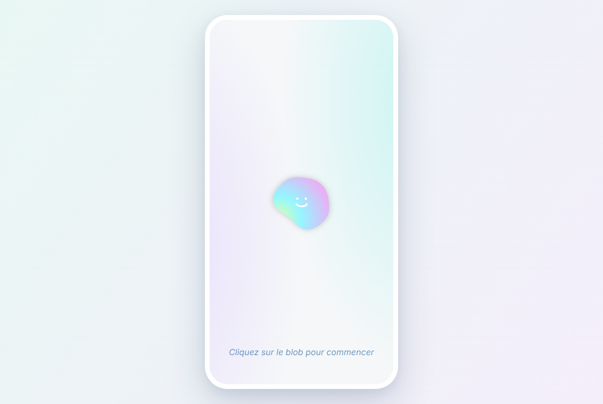
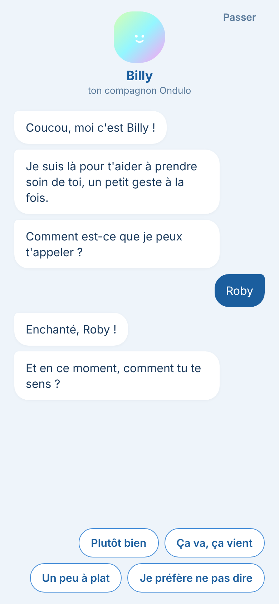
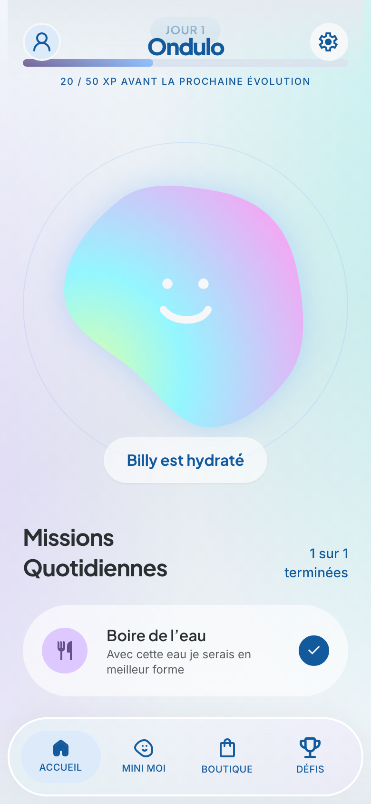

# Ondulo

Ondulo est une app de bien-être pensée pour les personnes qui vivent seules. On y prend soin de soi au quotidien avec **Billy**, un petit blob animé qui ondule, grandit et reprend des couleurs à mesure que les missions du jour (bouger, se laver, bien manger) sont accomplies.

Au premier lancement, on touche le blob pour le réveiller, puis il fait connaissance au fil d'une conversation : il demande qu'on lui donne un prénom, puis le tien, ta date d'anniversaire, ton quotidien, son allergie (pour les recettes) et ta couleur préférée. Il donne ensuite la première mission : boire un grand verre d'eau, avec une photo souvenir.

Les écrans suivent la maquette Figma *Product Design – Ondulo App* :

- **Accueil** : jour, XP avant la prochaine évolution, Billy et les missions du jour
- **Mini Moi** : Billy, les étoiles gagnées et l'historique des missions
- **Boutique** : accessoires achetés avec les étoiles
- **Défis** : une recette pas à pas (ingrédients puis étapes) et un parcours de marche

Le bouton réglages permet de tout recommencer.

Tout reste sur l'appareil : aucun compte, aucun serveur, aucun appel réseau. La progression est enregistrée localement (`localStorage` sur le web, stockage natif sur mobile). La photo de mission n'est jamais enregistrée.

## Captures

| Web (desktop) | Onboarding (mobile) | Accueil (mobile) |
| --- | --- | --- |
|  |  |  |

## Stack

- [Expo](https://expo.dev) SDK 54 / React Native 0.81, un seul code pour iOS, Android et le web (`react-native-web`)
- Billy ondule avec `react-native-reanimated` (contour SVG animé), visuels en `react-native-svg` et `expo-linear-gradient`
- Navigation par onglets et piles avec React Navigation
- Polices Plus Jakarta Sans et Inter (`@expo-google-fonts`), embarquées dans l'app
- Caméra : `expo-camera` sur mobile, `getUserMedia` sur le web

## Lancer en local

Prérequis : Node.js 20 ou plus.

```bash
npm install
npm run web        # version web sur http://localhost:8081
npm start          # mobile : scanner le QR code avec Expo Go
```

Sur un écran large, l'app s'affiche dans un cadre de téléphone centré. En dessous de 600 px de large (mobile, iframe étroite), elle occupe tout l'écran.

## Build web

```bash
npm run build:web  # génère le site statique dans dist/
npx serve -s dist  # pour tester le build
```

## Déploiement

Le site est déployé sur [Vercel](https://vercel.com) à chaque push. La configuration est dans `vercel.json` : build `npm run build:web`, dossier de sortie `dist`, et réécriture de toutes les routes vers `index.html` (SPA).

L'APK Android est construit par le workflow GitHub Actions `.github/workflows/build-apk.yml`.

## Assets Figma

Les icônes, blobs et la carte sont exportés tels quels du fichier Figma et listés dans `assets/figma/manifest.json` (nom du fichier, asset Figma, nœud et taille). Le module `src/assets/figma.ts` les expose aux écrans.

Billy est dessiné en `react-native-svg` à partir du contour Figma : `python3 scripts/figma-blobs.py` convertit les SVG des blobs en `src/assets/blobs.ts`, et `BillyBlob` fait onduler ce contour en continu (chaque point d'ancrage bouge à son rythme) pendant qu'il respire.

## Intégration en iframe

L'app peut être affichée dans une iframe. Pour que la photo de mission puisse utiliser la caméra, l'iframe doit l'autoriser :

```html
<iframe src="https://ondulo.vercel.app" title="Ondulo" allow="camera" width="420" height="860" style="border:0"></iframe>
```

Sans cette autorisation, la mission se valide sans photo.

## Structure

```
App.tsx                  polices, navigation (onglets, pile Défis, photo)
src/screens/             Accueil, Mini Moi, Boutique, Défis, Recette, Parcours, Photo
src/screens/onboarding/  splash, lancement, conversation avec Billy
src/components/          en-têtes, barre d'onglets, Billy, caméra, cadre web, composants communs
src/state/               état de l'app et persistance locale
src/constants/           thème, missions, boutique, défis, script de la conversation
src/assets/figma.ts      registre des assets Figma (assets/figma/)
public/index.html        page HTML de la version web
```
